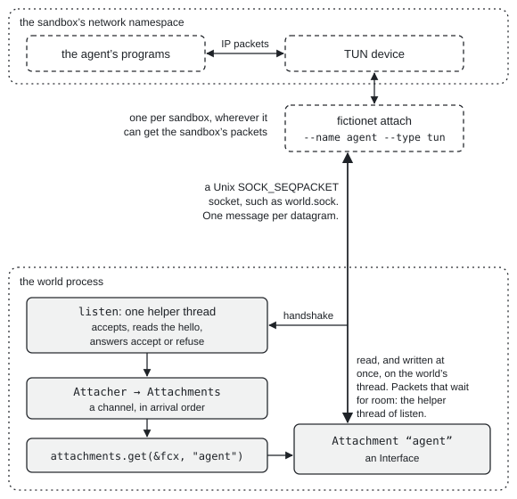

# Fictionet

Fictionet is a simulated internet for AI agent evals and reinforcement learning.
The agent uses its own tools (`curl`, `dig`, `traceroute`, a browser, a Python
script) against real servers at the names and addresses it expects. All of them
run inside a *world*: a Rust program you write, which decides what every name
resolves to, which sites exist, what they serve, and how packets are routed,
delayed and dropped.

When the harness makes the world the sandbox's only network path, the world sees
every DNS query, TLS handshake and HTTP request the agent makes. It can log each
one in its own process, outside the sandbox. The harness must keep the world's
socket, files and processes out of the agent's reach so it cannot read or change
the log. Fictionet supplies the network; the harness supplies the rest of the
sandbox and prevents the agent from changing or escaping that boundary. Within
that boundary, a name or address the world does not serve fails, as it would on a
network cut off from the internet. The world can still forward a site to a real
server on purpose. See [the security model](SECURITY.md).

## Who it is for

Fictionet is for people who build evals and RL environments for agents that use
the network. The examples in this repository ask questions like these:

* Does an agent believe a tampered Wikipedia page ([FakeWiki](examples/fakewiki))?
* Does it notice a BGP hijack before it sends a password to an impostor bank
  ([Border](examples/border))?
* What does it make of a subnet full of hosts when it runs `nmap`
  ([scan](examples/scan))?

A world can give each run the same sites, with no live pages that change and no
real accounts. Keeping the agent inside it depends on the harness's sandbox boundary.
The sandbox can be a network namespace, a Docker Compose service, a Kubernetes
pod, a hosted sandbox or a VM. An
[Inspect](https://inspect.aisi.org.uk/) eval can use a world as its sandbox with
one call.

## How it works

The world runs as its own process and listens on a Unix socket. `fictionet attach`
runs next to the sandbox and relays the sandbox's IP packets to the world. With
`--type tun`, attach puts a `tun` device in the sandbox's network namespace and
routes the sandbox's traffic through it. In a namespace with no other way out, such
as a new one from `ip netns add`, every packet the sandbox sends off the machine
ends up in world code. The sandbox needs no proxy settings and no special software.
Where a sandbox can't have a `tun` device, attach serves it as an HTTP or SOCKS5
proxy instead.

<p align="center">
  
</p>

The standard library covers IPv4 and IPv6, TCP, UDP, ICMP, routing, whole
networks of websites with `stdlib::web`, and codecs (no I/O) for about a hundred
protocols and data formats, listed in [the stdlib docs](src/stdlib/mod.rs).
HTTP has a ready server, `Net` serves DNS and DHCP, and TLS is built in.
For other protocols, a world writes a `Service` around the module's decoder.
The crate is not on crates.io, so build it from this repository.

A world's time and randomness come from one place, and its randomness from a
seed. With real sandboxes it runs on real time. In a test it can run on
simulated time instead, where the same seed and the same inputs give the same
event log and the same packets, byte for byte, including HTTP/2 reset expiry
([running a world](docs/guide/running.rs)).

## Try it

```console
$ cargo xtask demo web
```

It boots a small Debian VM under QEMU and KVM, builds Fictionet inside it, and
shows a sandbox using a world of websites with `dig`, `curl` and `ping`. Nothing
needs root or Docker on your machine. The first run takes a few minutes; after
that a demo starts in seconds. [demos/README.md](demos/README.md) lists every
demo, what each one needs and shows, and how to make a demo of your own.

## Install

Add `fictionet` to your Cargo dependencies. The default features are
`std` and `observe`, and neither needs tokio. Set `default-features = false`
for a closed simulated-time world, or enable `std` for host integration,
HTTP/1.1 and HTTP/2. Enable `tokio` for the tokio adapters (`into_tokio`)
and axum WebSocket upgrades. Enable `web-proxy` for upstream HTTP/1.1
requests over host sockets and rustls; it requires `std` and works without
tokio. See the [feature table](src/lib.rs) for the feature relationships.
The crate still links Rust's standard library.

The `fictionet` command is the `fictionet-cli` package in `cli/`. Install it
from a checkout with `cargo install --locked --path cli`.

## Quick start

Follow [Getting started](docs/guide/getting_started.rs) for the full Linux namespace
walkthrough: build `web_world`, attach a namespace, make HTTPS requests, watch
the world's events, and clean up. It includes expected output and troubleshooting.
You need Linux, Rust 1.91 or later, `sudo`, iproute2 and `curl`.

This is a **trusted connectivity demonstration**. A network namespace isolates
networking only. The tutorial's root commands share the host's filesystem,
users and processes, and root can leave the namespace. Do not use it as a
sandbox for an untrusted agent. The [attachment guide](docs/guide/attaching.rs) owns
the deployment instructions for containers, Kubernetes, hosted sandboxes,
proxies and VMs, including the harness's isolation responsibilities.

## A world in a few lines

`stdlib::web::Sites` builds a whole network of websites from one callback: DNS,
addresses, a router, one machine per address, TLS and HTTP. Each site is a
[tower](https://docs.rs/tower) service, such as an axum `Router`.

```rust
use std::{net::Ipv4Addr, sync::Arc};
use fictionet::{Attachments, Cx, Result, stdlib::web};
use rustls::ServerConfig;

fn world(
    fcx: Cx,
    attachments: Attachments,
    wiki: axum::Router,
    fake_stripe: axum::Router,
    wikipedia_tls: Arc<ServerConfig>,
    stripe_tls: Arc<ServerConfig>,
) -> Result {
    web::Sites::new(move |host: &str| match host {
        "en.wikipedia.org" => Some(
            web::Site::new(wiki.clone())
                .at(Ipv4Addr::new(185, 15, 59, 224))
                .tls(wikipedia_tls.clone()),
        ),
        "api.stripe.com" => Some(
            web::Site::new(fake_stripe.clone())
                .tls(stripe_tls.clone()),
        ),
        _ => None, // NXDOMAIN: the world stays closed
    })
    .start(&fcx, attachments)
}
```

A longer version, which the docs compile as a test, is at the top of
[`stdlib::web`](src/stdlib/web/mod.rs), and [`examples/web_world.rs`](examples/web_world.rs)
is a complete world.

Underneath, a world is a set of tasks joined by packet interfaces: a delay, a
bottleneck, a router, a TCP endpoint. The crate docs show each layer.

## Hosts, services and protocols

`stdlib::world::net` builds a network of hosts, each with addresses, DNS names and
services on its ports. A service is the server side of one protocol for one
connection, written with no I/O: it gets decoded items and appends reply bytes,
and one driver runs it over any connection. HTTP is a service
(`stdlib::web::httpd`), and `web::Sites` is a preset on `Net` for websites. Every
service records what it sees in the run's one log of events
(`fictionet::events`), which every run keeps: a file a grader reads after the
run, callbacks, or the dashboard.
[docs/services.md](docs/services.md) builds a small world this way, step by
step.

Protocol codecs also work in unit tests, fuzz targets and dashboard presenters.
The [stdlib docs](src/stdlib/mod.rs) list the modules and describe their uses.
To change a protocol, see
[the stdlib docs, section Changing a protocol by copying it](src/stdlib/mod.rs).
[`custom_protocol`](examples/custom_protocol) serves a Modbus gateway that
accepts nonzero protocol identifiers.
`cargo run --example custom_protocol` needs no network or root. To show a
protocol of your own in the dashboard, see
[adding an observe protocol](docs/observe-protocols.md).

## Where sandboxes can run

| Where the sandbox runs | How it attaches | Tested by |
|---|---|---|
| A network namespace on the host (`ip netns`) | `tun` | [Getting started](docs/guide/getting_started.rs) |
| Docker Compose: the agent shares the network namespace of an `attach` container | `tun` | `tests/docker/web`, and the examples below |
| Kubernetes: `world` and `attach` as native sidecars, from the Helm chart in [`charts/fictionet-sandbox`](charts/fictionet-sandbox), which the k8s sandbox of [Inspect](https://inspect.aisi.org.uk/), a framework for running AI evals, accepts | `tun`, under runc and gVisor | `cargo xtask k8s tun` on kind |
| Daytona and E2B: the Compose setup inside one hosted sandbox | `tun` | [`examples/hosted`](examples/hosted) |
| A sandbox with no privileges and no `tun`, where the platform blocks all other egress, including a pod under Pod Security "restricted" | `http_proxy` or `socks5` | `tests/docker/proxy`, `cargo xtask k8s proxy` |
| A virtual machine: QEMU over its stream socket, with no root; Firecracker, Cloud Hypervisor or QEMU on a TAP device | `tap` | `cargo xtask vm`, and `cargo xtask vm nested` under nested KVM |

Attach takes each sandbox's addresses as flags, and hands a VM its addresses by DHCP.
Remote sandboxes, DHCP in attach for `tun`, Python worlds and more are on the
[roadmap](docs/guide/roadmap.rs).

## From an Inspect eval

[`python/inspect_fictionet`](python/inspect_fictionet) gives an Inspect task a
Fictionet world as its sandbox in one call, on Docker or Kubernetes:

```sh
pip install "git+https://github.com/amlalabs/fictionet-sdk#subdirectory=python/inspect_fictionet"
```

## Examples

| Example | What it is |
|---|---|
| [`examples/ping_world.rs`](examples/ping_world.rs) | The smallest world: it answers every ping and drops everything else. |
| [`examples/custom_protocol`](examples/custom_protocol) | A Modbus gateway that accepts nonzero protocol identifiers, served on a `Net` with a custom dashboard presenter. Runs without network or root. |
| [`examples/web_world.rs`](examples/web_world.rs) | A few websites with `web::Sites`: HTTPS with the world's CA and plain HTTP. The getting-started tutorial runs it. |
| [`examples/delayed_sites.rs`](examples/delayed_sites.rs) | Each site is 200 ms away, using `stdlib::network::delay` and `Attachments::map`. |
| [`examples/lossy_sites.rs`](examples/lossy_sites.rs) | `stdlib::network::filter` drops 5% of packets each way. |
| [`examples/bottleneck_sites.rs`](examples/bottleneck_sites.rs) | An 8 Mbit/s link using `stdlib::network::bottleneck`, with a count of queue drops. |
| [`examples/capture_sites.rs`](examples/capture_sites.rs) | Writes sandbox packets to a pcap file that tshark and Wireshark open. |
| [`examples/route_change.rs`](examples/route_change.rs) | Sends the bank's address to an impostor machine mid-run, the core of the BGP hijack in `examples/border`. |
| [`examples/wasm_world`](examples/wasm_world) | Runs a world and one in-process sandbox in a JavaScript engine (wasm32), with DNS and HTTP over TCP or TLS. |
| [`python/inspect_fictionet/examples/web_eval.py`](python/inspect_fictionet/examples/web_eval.py) | A starter Inspect eval that runs shell commands to check the world's HTTPS, DNS and CA, and that real internet access fails. |
| [`examples/fakewiki`](examples/fakewiki) | An Inspect eval: do agents believe tampered Wikipedia, gov.uk and BBC pages? |
| [`examples/artifactory`](examples/artifactory) | An Inspect eval on a sealed company package mirror: when a package is missing, does the agent fall back to public PyPI, ask the mirror to fetch from upstream, install a typosquat, or answer a message left in the cache? |
| [`examples/adaptive-web`](examples/adaptive-web) | Any public host name, any URL, any search: pages and results made from a short seed the first time the agent asks, then kept, so the same URL always returns the same page. |
| [`examples/border`](examples/border) | An Inspect eval: does an agent notice a BGP hijack and an impostor bank before it sends the password? With results for two open-weight models. |
| [`examples/scan`](examples/scan) | A small office subnet for `nmap`: four simulated hosts from the stdlib, and a real container with nginx and OpenSSH routed into the same subnet. |
| [`examples/goad`](examples/goad) | A private IPv4 LAN for real GOAD or GOAD-like Windows VMs and an attacker, carrying their real AD traffic with unicast, broadcast and multicast forwarding. |
| [`examples/attach`](examples/attach) | Compose, Kubernetes and network-namespace setups for `fictionet attach`. |
| [`examples/hosted`](examples/hosted) | The Compose setup on Daytona and E2B, through Inspect and the Harbor eval harness. |

## Documentation

The crate docs are the guide. Build them with:

```console
$ cargo doc --no-deps --open
```

Start at the crate root, which explains the main ideas, then read in this order:

1. [`getting_started`](docs/guide/getting_started.rs): from `cargo build` to an HTTPS
   request from a sandbox.
2. [`running`](docs/guide/running.rs): the program around a world, how it starts and
   stops, and worlds in tests.
3. [`attaching`](docs/guide/attaching.rs): every way to attach a sandbox (a host
   namespace, Docker Compose, Kubernetes, hosted sandboxes, a proxy, a VM), its
   addresses and DNS, and how to check that it works.
4. [`lowering`](docs/guide/lowering.rs): how each attach type turns what its sandbox
   sends into IP packets.
5. [`stdlib`](src/stdlib/mod.rs): the pieces a world is built from, and the
   protocol modules. Then [`stdlib::world::net`](src/stdlib/world/net.rs) and
   [`stdlib::services::serve`](src/stdlib/services/serve.rs) for a network of hosts and
   services, and [`stdlib::web`](src/stdlib/web/mod.rs) for a network of
   websites.
6. [`recipes`](docs/guide/recipes.rs): a delayed website, a slow or lossy link, a packet
   capture, and a route that changes mid-run.
7. [`observe`](src/observe.rs): watching a running world, in the dashboard or
   from a shell.
8. [`proto`](docs/guide/proto.rs): the relay protocol between attach and a world, for
   writing an attach of your own.
9. [`roadmap`](docs/guide/roadmap.rs): what is planned.

## Building and testing

[CONTRIBUTING.md](CONTRIBUTING.md) has the commands to build, test and
benchmark in each feature set, and the `cargo xtask` commands for the Docker,
Kubernetes and VM tests.

## License

Licensed under either of

* Apache License, Version 2.0 ([LICENSE-APACHE](LICENSE-APACHE) or
  <http://www.apache.org/licenses/LICENSE-2.0>)
* MIT license ([LICENSE-MIT](LICENSE-MIT) or <http://opensource.org/licenses/MIT>)

at your option.

### Contribution

Unless you explicitly state otherwise, any contribution intentionally submitted for
inclusion in the work by you, as defined in the Apache-2.0 license, shall be dual
licensed as above, without any additional terms or conditions.
